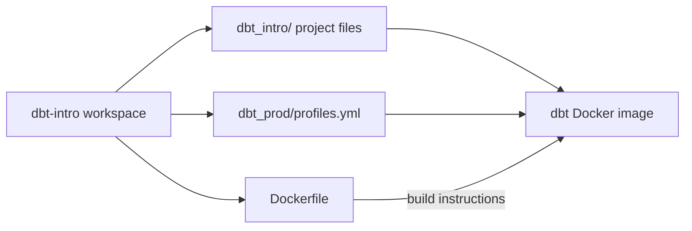
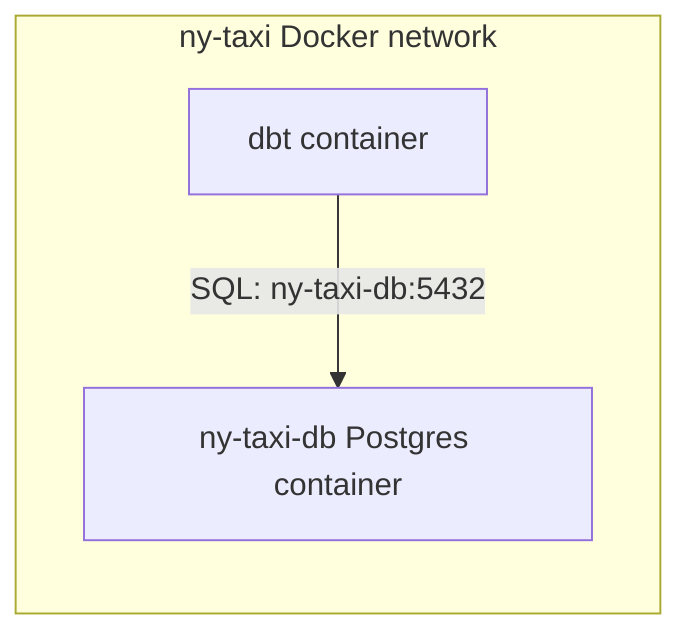

# Run dbt in Docker

This guide is the next step after [01-dbt-intro](./01-dbt-intro.md). It assumes you already have:

- a working `dbt_intro` project,
- a Postgres container called `ny-taxi-db`,
- the `ny_taxi` database populated with the source data from 01.

The goal here is simple: package that working dbt project into a Docker image and run dbt inside a container instead of your local Python environment.

## Before you start

Start from the completed workspace from 01. In other words, do not run these steps from the repository root. Use the fresh `dbt-intro/` workspace you built in chapter 01.

Docker must be running before you start, because this chapter assumes both the existing `ny-taxi-db` container and the Docker build engine are available.

## What we are dockerizing

You should be in the **workspace root from 01**. Your folder should look roughly like this:

```text
dbt-intro/
  ├── data/
  ├── dbt_intro/
  └── logs/
```

We will add a few more things to that workspace root:

- `dbt_prod/profiles.yml`
- `Dockerfile`



## Why run dbt in Docker?

Running dbt in Docker is useful because it gives you:

- a repeatable runtime with a fixed Python and dbt version,
- a cleaner path toward CI/CD or production orchestration,
- a way to run dbt without depending on a locally activated virtual environment.

## 1. Put Postgres and dbt on the same Docker network

In 01, you connected to Postgres from your host machine through port `5432`. In Docker, the dbt container must reach Postgres **container-to-container**, so both containers need to be on the same Docker network.

Create the network if it does not exist:

```bash
docker network create ny-taxi 2>/dev/null || true
```

Connect the existing Postgres container from 01:

```bash
docker network connect ny-taxi ny-taxi-db 2>/dev/null || true
```

If the second command says the container is already connected, that is fine.

### Why `POSTGRES_HOST` is not `localhost`

Inside the dbt container, `localhost` means "this dbt container," not your database container. That is why we will use:

```text
POSTGRES_HOST=ny-taxi-db
```

`ny-taxi-db` is the Postgres container name, and Docker's internal network can resolve it automatically.



## 2. Create a production profile for the container

From the `dbt-intro` workspace root, create a folder for the production profile:

```bash
mkdir -p dbt_prod
```

Create `dbt_prod/profiles.yml` with:

```yaml
dbt_intro:
  outputs:
    prod:
      type: postgres
      threads: 4
      host: "{{ env_var('POSTGRES_HOST') }}"
      port: 5432
      user: "{{ env_var('POSTGRES_USER') }}"
      pass: "{{ env_var('POSTGRES_PASSWORD') }}"
      dbname: "{{ env_var('POSTGRES_DB') }}"
      schema: dbt_prod

  target: prod
```

This profile keeps credentials and host information out of the image itself. At runtime we inject them through environment variables.

### Expected schema names in production

If you followed 01 and your models use custom schemas such as `stg`, `int` and `driver`, then dbt's default schema naming behavior gives you:

- `dbt_prod_stg`
- `dbt_prod_int`
- `dbt_prod_driver`

That mirrors the local `dbt_dev_*` pattern from 01.

One small detail to expect:

- seeds land in the base target schema such as `dbt_prod`,
- models that declare custom schemas land in prefixed schemas such as `dbt_prod_stg`, `dbt_prod_int` and `dbt_prod_driver`.

## 3. Create the `Dockerfile`

Still in the `dbt-intro` workspace root, create a `Dockerfile`:

```dockerfile
FROM ghcr.io/astral-sh/uv:0.13.5 AS uv
FROM python:3.13.17-slim-bookworm

RUN apt-get update \
    && apt-get install -y --no-install-recommends ca-certificates git \
    && rm -rf /var/lib/apt/lists/*

WORKDIR /app

ENV UV_COMPILE_BYTECODE=1 \
    UV_LINK_MODE=copy

COPY --from=uv /uv /uvx /bin/
COPY pyproject.toml uv.lock ./
RUN uv sync --locked --no-dev --no-install-project

COPY dbt-intro/dbt_intro/ /app/
COPY dbt-intro/dbt_prod/ /root/.dbt/

ENTRYPOINT ["uv", "run", "--no-sync", "dbt"]
```

### What gets copied into the image?

- `pyproject.toml` and `uv.lock` install the exact same, locked dependency set you already synced via `uv sync` in the repository's [README](./README.md) setup. `uv sync --locked` fails loudly if the lockfile is out of date instead of silently drifting; `--no-dev` skips dev-only tooling and `--no-install-project` skips installing this repo as a package, since it is not one.
- `dbt-intro/dbt_intro/` becomes `/app/`.
- `dbt-intro/dbt_prod/profiles.yml` becomes `/root/.dbt/profiles.yml`.

We also install `git` so `dbt debug` behaves cleanly inside the container instead of failing on the dependency check. The entrypoint runs `dbt` through `uv run --no-sync`, which reuses the environment `uv sync` already built at image-build time instead of re-checking it on every container start.

## 4. Build the image

Still in the `dbt-intro/` workspace, build with its Dockerfile and the parent repository as the context:

```bash
docker build -f Dockerfile -t dbt-intro ..
```

The trailing `..` uses the repository root as the build context, so Docker can access the shared `pyproject.toml` and `uv.lock`. Leave those files at the root; no copies or second local environment are needed.

If the build succeeds, you now have an image that can run dbt commands through the image entrypoint.

## 5. Validate the container with `dbt debug`

Run:

```bash
docker run --rm \
  --network=ny-taxi \
  -e POSTGRES_USER=postgres \
  -e POSTGRES_PASSWORD=postgres \
  -e POSTGRES_HOST=ny-taxi-db \
  -e POSTGRES_DB=ny_taxi \
  dbt-intro debug
```

Expected result:

- dbt finds `/root/.dbt/profiles.yml`,
- dbt loads `/app/dbt_project.yml`,
- the Postgres connection succeeds,
- `All checks passed!` appears at the end.

## 6. Run `dbt seed` in the container

Now load your seeds from inside the image:

```bash
docker run --rm \
  --network=ny-taxi \
  -e POSTGRES_USER=postgres \
  -e POSTGRES_PASSWORD=postgres \
  -e POSTGRES_HOST=ny-taxi-db \
  -e POSTGRES_DB=ny_taxi \
  dbt-intro seed
```

Expected result:

- dbt loads your CSV seeds into the `dbt_prod` target schema,
- for example, the `payment_type` seed from 01 lands in `dbt_prod.payment_type`.

## 7. Run `dbt run` in the container

Build your models:

```bash
docker run --rm \
  --network=ny-taxi \
  -e POSTGRES_USER=postgres \
  -e POSTGRES_PASSWORD=postgres \
  -e POSTGRES_HOST=ny-taxi-db \
  -e POSTGRES_DB=ny_taxi \
  dbt-intro run
```

If you completed 01, this should build the same project logic as before, but now in the `prod` target instead of `dev`.

Typical outputs from the 01 tutorial project are:

- `dbt_prod_stg.stg_yellow_taxi`
- `dbt_prod_int.int_avg_tips`
- `dbt_prod_int.int_avg_tips_per_payment_type`
- `dbt_prod_driver.fct_best_tips`

## 8. Optional: Run tests in the container

If you also added the realistic tests from 01, you can run them in Docker as well:

```bash
docker run --rm \
  --network=ny-taxi \
  -e POSTGRES_USER=postgres \
  -e POSTGRES_PASSWORD=postgres \
  -e POSTGRES_HOST=ny-taxi-db \
  -e POSTGRES_DB=ny_taxi \
  dbt-intro test
```

This is the same project validation step as 01, just executed inside the containerized runtime.

## 9. Summary

At this point you have:

- a local `dbt_intro` project from 01,
- a production profile that reads credentials from environment variables,
- a Docker image that contains the project and dbt runtime,
- validated `debug`, `seed`, and `run` commands executed inside the container.

That gives you a clean bridge from a local dbt workflow to a deployable container-based workflow.
