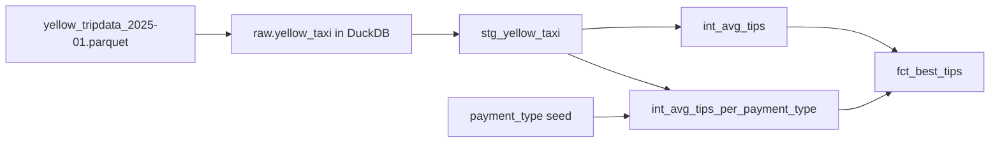
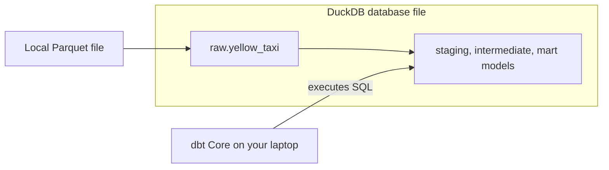

# Optional: Free Analytics with DuckDB

This guide is a follow-up to [01-dbt-intro](./01-dbt-intro.md) and [02-dockerize-dbt](./02-dockerize-dbt.md). You will run the same `dbt_intro` project, this time with **DuckDB**.

Think of this chapter as a **DuckDB-based alternative runtime**, not a replacement project. You keep the same dbt project and models from 01. The main change is that dbt connects to DuckDB instead of Postgres.

This chapter is **optional**. If your goal is simply to learn dbt on a real database and then run it in Docker, chapters 01 and 02 are already enough.

The value of doing 03 is different:

- it shows that the same dbt project can move between adapters with only small changes,
- it gives you a zero-server analytics option for quick experiments,
- it lets you compare a traditional database runtime with a lightweight file-based runtime,
- it gives you a file-based fallback when you do not want to keep Postgres running.

DuckDB is a good fit here because it:

- is free,
- runs directly on your laptop,
- can read Parquet data quickly,
- keeps the setup small enough for a beginner tutorial.

## Free options at a glance

As of the time of writing, these are the main free options if you want to keep the stack simple:

| Option | Cost | Why you might choose it | Why it is not the default here |
|---|---|---|---|
| [DuckDB + dbt Core](https://duckdb.org/) | Free | No account, no cloud setup, very fast local analytics | --- |
| [Neon + dbt Core or dbt Cloud](https://neon.com/pricing) | Free tier available | Hosted Postgres with a familiar SQL database workflow | Still requires a hosted database and remote connection setup. |
| [dbt Cloud Developer](https://www.getdbt.com/pricing) | Free tier available | Managed dbt UI and scheduled jobs | Still adds more setup and moving parts than a DuckDB-based run. |

If your goal is **the fewest steps possible**, choose DuckDB.

## What you will build

You should start from the **same workspace you created in 01**. At this point, it should look something like this:

```text
dbt-intro/
  ├── data/
  ├── dbt_intro/
  ├── dbt_prod/
  └── logs/
```

By the end of this chapter, the workspace will also contain a DuckDB database file:

```text
dbt-intro/
  ├── data/
  ├── dbt_intro/
  ├── dbt_prod/
  ├── logs/
  └── ny_taxi.duckdb
```



## Before you start

This chapter assumes you already completed 01 and therefore already have:

- a `dbt_intro` project,
- the January 2025 Parquet file in `data/yellow_tripdata_2025-01.parquet`,
- the staging, intermediate, mart and seed files from 01,
- the repository root's `uv sync` environment installed.

If you did not complete 01 yet, go back there first. This chapter intentionally reuses that project instead of creating a separate one.

`dbt-duckdb` (and `duckdb` itself) are already part of the repository's `pyproject.toml`, alongside `dbt-postgres`, so the `uv sync` from the repository's [README](./README.md) setup already installed everything this chapter needs.

## 1. Create a local DuckDB database

Create a DuckDB database file in the workspace root and load the raw source table into it:

```bash
uv run python - <<'PY'
import duckdb

con = duckdb.connect("ny_taxi.duckdb")
con.execute("create schema if not exists raw")
con.execute(
    """
    create or replace table raw.yellow_taxi as
    select *
    from read_parquet('data/yellow_tripdata_2025-01.parquet')
    """
)

row_count = con.execute(
    "select count(*) from raw.yellow_taxi"
).fetchone()[0]

print(f"Loaded {row_count} rows into raw.yellow_taxi")
PY
```

If you load the full January 2025 file, the row count should be **3,475,226**.

This keeps the raw source local and easy to inspect.

### Expected raw source

Before running dbt, make sure the raw table `raw.yellow_taxi` exists and that it contains the same source columns used in 01:

```text
VendorID
tpep_pickup_datetime
tpep_dropoff_datetime
passenger_count
trip_distance
RatecodeID
store_and_fwd_flag
PULocationID
DOLocationID
payment_type
fare_amount
extra
mta_tax
tip_amount
tolls_amount
improvement_surcharge
total_amount
congestion_surcharge
Airport_fee
cbd_congestion_fee
```

To do this, run:

```bash
uv run python - <<'PY'
import duckdb

con = duckdb.connect("ny_taxi.duckdb")
con.execute("""
SELECT 1
FROM information_schema.tables
WHERE table_schema = 'raw'
  AND table_name = 'yellow_taxi'
""").fetchone()[0]

columns = con.execute("""
SELECT column_name
FROM information_schema.columns
WHERE table_schema = 'raw'
  AND table_name = 'yellow_taxi'
ORDER BY ordinal_position
""").fetchall()

print("raw.yellow_taxi exists and has the following columns:")
for col in columns:
    print(col[0])
PY
```

## 2. Add a DuckDB target to `profiles.yml`

Open `~/.dbt/profiles.yml` and extend the existing `dbt_intro` profile from 01.

If your file currently has `dev` and `prod` outputs for Postgres, keep them. Add a new `duckdb` output and make it the active target:

```yaml
dbt_intro:
  outputs:

    dev:
      dbname: ny_taxi
      host: localhost
      pass: postgres
      port: 5432
      schema: dbt_dev
      threads: 4
      type: postgres
      user: postgres

    prod:
      dbname: ny_taxi
      host: localhost
      pass: postgres
      port: 5432
      schema: dbt_prod
      threads: 4
      type: postgres
      user: postgres

    duckdb:
      type: duckdb
      path: ../ny_taxi.duckdb
      schema: dbt_duckdb
      threads: 4

  target: duckdb
```

If you would rather keep Postgres as the default target, leave `target: dev` in place and add `--target duckdb` to each dbt command in this chapter.

### Why `path: ../ny_taxi.duckdb`?

In the next steps you will run dbt from inside the `dbt_intro/` project directory. From that directory:

```text
../ny_taxi.duckdb
```

points back to the workspace root where the DuckDB file lives.

With this target in place, dbt will build into DuckDB schemas such as:

- `dbt_duckdb`
- `dbt_duckdb_stg`
- `dbt_duckdb_int`
- `dbt_duckdb_driver`

That mirrors the `dbt_dev_*` and `dbt_prod_*` pattern you already saw in 01 and 02.

## 3. Make the source definition work for both Postgres and DuckDB

In 01, `models/staging/src_yellow_taxi.yml` pointed at:

```text
public.yellow_taxi
```

That was correct for Postgres, but the DuckDB version of this tutorial loads the raw table into:

```text
raw.yellow_taxi
```

Update `dbt_intro/models/staging/src_yellow_taxi.yml` so it works with either adapter:

```yaml
version: 2

sources:
  - name: src_yellow_taxi
    schema: "{{ 'raw' if target.type == 'duckdb' else 'public' }}"
    tables:
      - name: yellow_taxi
```

This is the one project-level change that makes the same dbt project work in both runtimes:

- `public.yellow_taxi` in Postgres
- `raw.yellow_taxi` in DuckDB

The SQL model `stg_yellow_taxi.sql` from 01 can stay the same. DuckDB understands the quoted mixed-case source columns just fine:

```sql
{{ config(materialized='table', schema='stg') }}

select
    "VendorID" as vendor_id,
    tpep_pickup_datetime as pickup_datetime,
    tpep_dropoff_datetime as dropoff_datetime,
    passenger_count,
    trip_distance,
    "RatecodeID" as rate_code_id,
    store_and_fwd_flag,
    "PULocationID" as pickup_location_id,
    "DOLocationID" as dropoff_location_id,
    payment_type,
    fare_amount,
    extra,
    mta_tax,
    tip_amount,
    tolls_amount,
    improvement_surcharge,
    total_amount,
    congestion_surcharge,
    "Airport_fee" as airport_fee,
    cbd_congestion_fee
from {{ source('src_yellow_taxi', 'yellow_taxi') }}
```

## 4. Run the project in DuckDB

Move into the dbt project directory:

```bash
cd dbt_intro
```

### Validate the connection

```bash
uv run dbt debug
```

Expected result:

- dbt finds `~/.dbt/profiles.yml`,
- the active adapter is `duckdb`,
- the DuckDB connection succeeds,
- the command ends with `All checks passed!`.

### Load the seed

```bash
uv run dbt seed
```

Expected result:

- dbt loads `payment_type.csv`,
- the seed lands in the DuckDB target schema, so with the profile above it becomes `dbt_duckdb.payment_type`.

### Build the models

```bash
uv run dbt run
```

Expected result:

- `dbt_duckdb_stg.stg_yellow_taxi`
- `dbt_duckdb_int.int_avg_tips`
- `dbt_duckdb_int.int_avg_tips_per_payment_type`
- `dbt_duckdb_driver.fct_best_tips`

### Run the tests

```bash
uv run dbt test
```

The realistic tests from 01 still work here. You should see the same `PASS` results, now executed against DuckDB instead of Postgres.

### Generate the documentation

```bash
uv run dbt docs generate
```

This writes the docs artifacts into the local `target/` directory just like before.

## Why this version is simpler



The moving parts in this chapter are:

- the `dbt-duckdb` adapter,
- one DuckDB database file,
- one small source-config change in `src_yellow_taxi.yml`.

That is why DuckDB is the best default for a free beginner path.

## Verification checklist

Use this checklist at the end of the chapter:

1. `uv run python - <<'PY' ... PY` loads `3475226` rows into `raw.yellow_taxi`.
2. `uv run dbt debug` ends with `All checks passed!`.
3. `uv run dbt seed` loads `dbt_duckdb.payment_type`.
4. `uv run dbt run` builds the staging, intermediate and mart models in DuckDB.
5. `uv run dbt test` finishes with all tests passing.
6. `uv run dbt docs generate` writes docs artifacts into `target/`.

If all six checks succeed, your dbt project works end to end in DuckDB.
